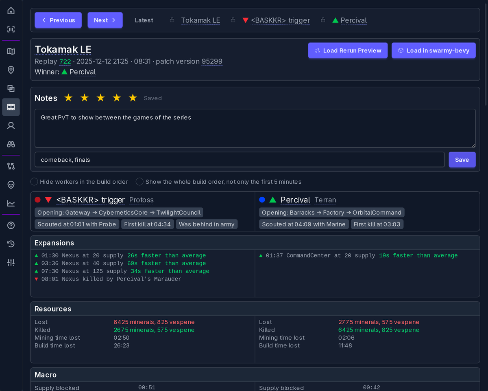

# swarmy, a StarCraft II replay batch analyser

swarmy reads a whole directory of StarCraft II replays at once to find trends: which units, openings
and timings are played on each map and patch, and how they change over time. Casters can prepare
statistics about players, maps, race balance (PvT, TvZ, ZvP...) and player vs player records, and go
through the replays of a series while casting.

- **Snapshot**: the replays are decoded by [s2protocol-rs](https://github.com/sebosp/s2protocol-rs)
  into Arrow IPC files partitioned by day, only the new replays are read again, a watcher tells when
  there are new ones and the duplicates can be moved out of the way.
- **Views**: maps (minimap, resources, matchups), replays with filters by matchup, patch, time
  frame, tag, rating and chat messages, the analysis of a replay with notes, ratings and tags,
  players and their head to head records, where the units go in each map, the units of every
  patch and the evolution of their costs.
- **Viewers**: a replay in [Rerun](https://rerun.io) and in 3D on its map with
  [swarmy-bevy](https://github.com/sebosp/swarmy-bevy).

## Walkthrough

[The walkthrough video](docs/walkthrough.mp4) (5:13) goes from a fresh install through every view, with 834
replays of the RSL season:

| Time | Step |
|------|------|
| 0:00 | Home |
| 0:09 | Config: the map caches, the replays, the duplicate replays folder and the new replays watcher |
| 0:25 | Scan |
| 0:35 | Optimize |
| 0:51 | Duplicates moved to the duplicates folder |
| 1:10 | Map List, sorted by games |
| 1:17 | Map Details |
| 1:26 | Replay List of the PvT games of the map |
| 1:32 | Replay Detail: notes, rating, tags, locks, previous and next |
| 2:22 | Replay List: tags and chat messages |
| 2:50 | Player |
| 3:10 | Map Scout |
| 3:17 | Patch Overview |
| 3:22 | Unit Overview |
| 3:28 | Patch Evolution |
| 4:07 | Rerun preview |
| 4:37 | swarmy-bevy: the units died, born, of one unit type |

More in [Screenshots](docs/Screenshots.md).

## Documentation

- [Installation](docs/Installation.md): the releases, the first steps, the sidecars and the logs.
- [Screenshots](docs/Screenshots.md) of every view.
- [Statistics](docs/Statistics.md): what the snapshot has and what swarmy shows from it.
- [Roadmap](docs/Roadmap.md): the ideas for casters and what is left to do.
- [Development](docs/Development.md): building swarmy, the charts, the releases and the walkthrough.
- The Help view in swarmy explains how each statistic is calculated, the Changelog view what is
  new.

## Related projects

- [s2protocol-rs](https://github.com/sebosp/s2protocol-rs): decodes the replays and writes the
  snapshot, a rustified version of Blizzard's [s2protocol](https://github.com/Blizzard/s2protocol).
- [swarmy-bevy](https://github.com/sebosp/swarmy-bevy): the maps and replays in 3D.
- [Rerun](https://github.com/rerun-io/rerun): the replay preview.
- [s2-polars-data-analysis](https://github.com/sebosp/s2-polars-data-analysis): notebooks with
  Polars, DuckDB and functime on the snapshot.
